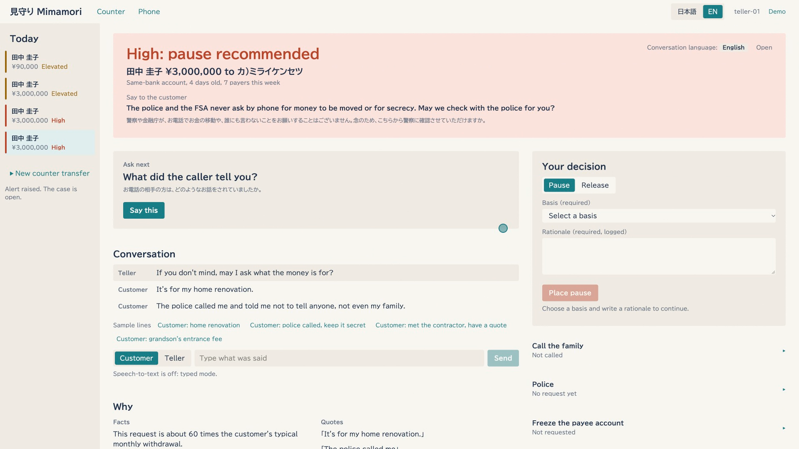
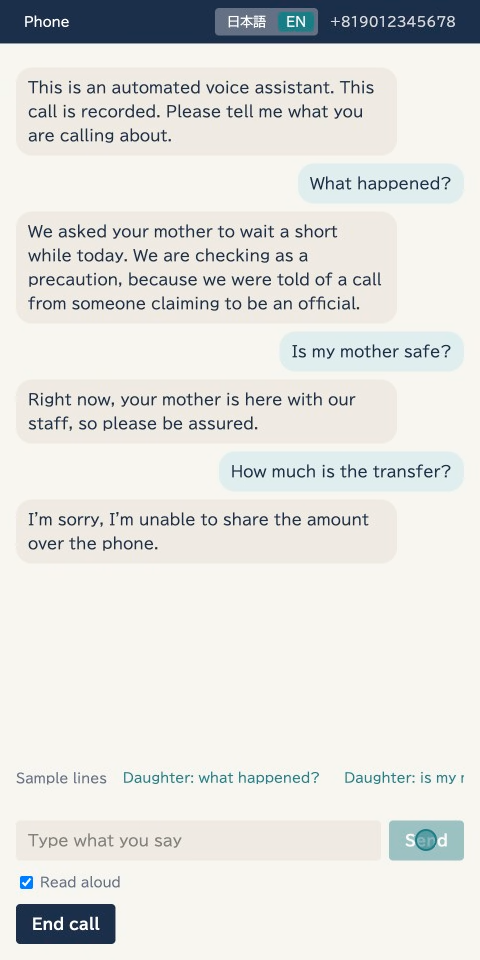
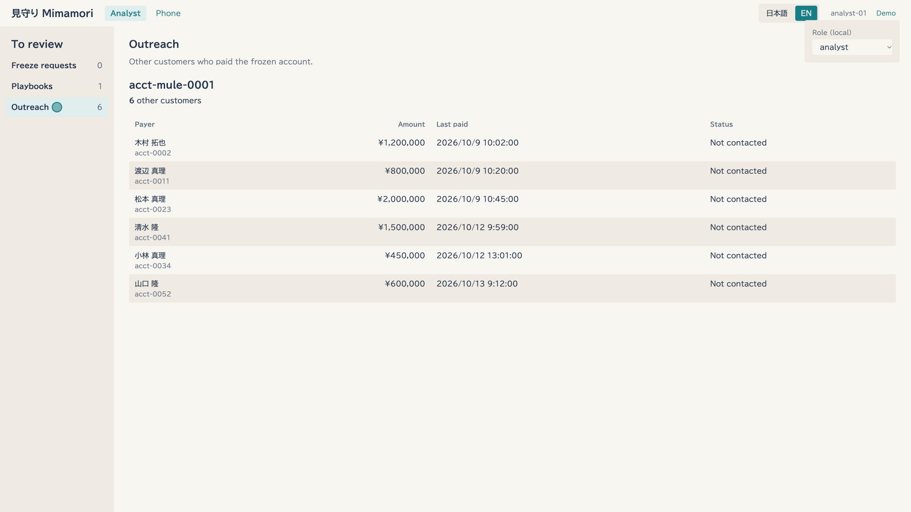

# Mimamori

**Decision support for bank tellers that stops fake-police scams at the counter, before the money moves.**

Mimamori ("watching over" in Japanese) reads the counter conversation, spots the signs of a coached
victim, and gives the teller the next question to ask, the evidence and a pause button. If the customer
agreed to it in advance, a voice assistant calls their family on a verified line. An analyst can then
freeze the account receiving the money and find the other people paying into it.

- **Live prototype:** https://web-ui-316555131232.asia-south1.run.app (synthetic data only; see [Try it](#try-it))
- **Demo video (3 min):** _link to be added_
- Built for the AI Builder Cup 2026, BFSI track. All data in this repository is synthetic.

## The problem

In fake-police scams (ニセ警察詐欺), a caller pretends to be a police officer, tells the victim their
account is involved in a crime, and has them move their savings "for safekeeping", usually by bank
transfer. Japan's National Police Agency counted **¥100.5 billion in losses in 2025**
([NPA, 2026-06-05](https://www.npa.go.jp/bureau/safetylife/sos47/new-topics/260605/01.html)), and
**¥72.9 billion in January–August 2026 alone, 27% more than a year earlier**
([NPA, 2026-10-02](https://www.npa.go.jp/bureau/safetylife/sos47/new-topics/261002/01.html)). In the
first half of 2026, **65.6% of cases were paid by bank transfer**, 98.2% started with a phone call, and
the most common victims by number of cases were in their 70s
([NPA, 2026-07-31](https://www.npa.go.jp/bureau/safetylife/sos47/assets/img/new-topics/detail/260731/01/01.pdf)).

Banks are asked to speak to every customer making a large transfer. But the NPA itself notes that
scammers **coach victims on what to tell the counter**
([NPA](https://www.npa.go.jp/bureau/criminal/souni/tokusyusagi/teguchi-taisaku.pdf)). A teller
with a queue, a polite customer and a plausible story ("it's for my renovation") has seconds to decide.
The counter is the last point where a person can still stop the money.

## What Mimamori does

| Moment | What the teller, family or analyst sees |
|---|---|
| **1. The transfer is keyed in** | Before any money moves, a scoring service checks the payee: account age, how many people paid it this week, the customer's own baseline. A risky payee raises **Elevated**: a reason to ask, not an accusation. |
| **2. The counter conversation** | The copilot reads each customer turn and highlights the customer's exact words that match scam indicators ("the police told me not to tell anyone"). It suggests the next approved question and explains its reasoning. Indicators plus a risky payee raise **High: pause recommended**. |
| **3. The teller decides** | One decision panel: pause or release, the basis for the pause and a written reason. A person decides every time, and every decision is logged. The teller can issue a summary for the police. |
| **4. The family call** | If the customer registered a trusted contact in advance, the bank sends a notice. The family member calls back on the bank's published number with a case code. A voice assistant answers in approved wording only: what happened, is she safe, come to the branch. It never discloses amounts and never takes instructions. |
| **5. The analyst acts** | The analyst reviews the same evidence and approves a freeze of the receiving account. Mimamori then lists the **other customers who paid into it**, so the bank can contact them before they lose money too. |

<table>
<tr>
<td width="62%"></td>
<td></td>
</tr>
<tr>
<td colspan="2"></td>
</tr>
</table>

And just as important: **no false alarm.** A genuine renovation with a consistent story stays below High
and goes through. A small payment is never stopped. A stranger who calls back with a wrong code learns
nothing.

## Responsible AI by design

- **Models suggest; code decides.** The risk level comes from a deterministic rule (`risk-v1`), not a
  model score. Every quote the model cites is checked word-for-word against the transcript, and every
  fact against the tool result it came from; anything that fails is dropped.
- **A human makes every decision**: pause, release, police report and freeze, each with a logged reason.
- **Approved wording only.** Every sentence a teller reads or a family member hears comes from a
  bank-approved template, checked by a rule before it is spoken. The model only classifies what was
  asked. There is no free-form generation to customers and no Gemini Live API.
- **Untrusted text stays data.** Payee names, memos and transcripts go into delimited data blocks,
  never into instructions. Every structured model call uses constrained (schema) decoding.
- **Least data.** Gemini never sees customer records. The family call gets only a minimal brief, and
  each service can reach only the databases it needs.
- **No probability numbers** in any screen: tellers see levels and reasons.

## Built on Google Cloud

| Need | Google Cloud |
|---|---|
| Copilot, investigation agent, family-call intent | **Gemini 2.5 Flash on Vertex AI**, schema-constrained; the investigation agent runs on the Agent Development Kit (ADK) |
| Family-call voice | **Cloud Text-to-Speech**, Chirp 3 HD voices (Japanese and English) |
| Five services and three jobs | **Cloud Run**: public web UI, internal-only backends, scale to zero |
| Cases, playbooks, reference lists | **Firestore** (Native), three databases with per-database IAM conditions |
| CI/CD | GitHub Actions to **Artifact Registry** and Cloud Run through **Workload Identity Federation** (no service-account keys) |
| Logs | **Cloud Logging**: per-call model latency, every decision |


**Measured performance** (Gemini 2.5 Flash on Vertex AI): copilot turn 1.3–1.8 s; family-call intent
0.8–0.9 s; full investigation (8 read-only tools) about 7 s; transfer submission 0.05–0.11 s.

**Scalability and integration.** Scoring runs as a pre-transaction check in front of core banking. If it
is down or slow, the transfer goes ahead under the bank's existing controls (fail-open), so Mimamori
adds protection without becoming a single point of failure. A new country or language is a
**language pack** (templates, examples, scam playbooks and its legal basis); the rule that decides High
has no language. The demo runs the same case in Japanese and English.

## Try it

Open the [live prototype](https://web-ui-316555131232.asia-south1.run.app). Services scale to zero, so
the first load may take a few seconds.

- **Teller console:** _New counter transfer_, choose Tanaka (¥3,000,000 to the flagged payee), submit,
  then type what the customer says. Set the conversation language to English for an English case.
- **Phone:** `/phone` simulates the family member's phone (notice, callback, case code).
- **Analyst:** _Demo_ menu, role _Analyst_, to approve the freeze and see the outreach list.

The scripted demo drives the same flows in real browsers and records them:
`scripts/demo.sh <scenario> --url <live URL>` (see [`demo/README.md`](demo/README.md)).

## Run it locally

Needs Python 3.12, Docker and Node 24. With Gemini on Vertex AI
(`gcloud auth application-default login` once) or fully offline with Ollama (`gemma4:12b`):

```bash
scripts/dev.sh up            # Gemini on Vertex AI; or: scripts/dev.sh up --local  (Ollama, no GCP)
scripts/demo.sh all          # resets the stack and runs every scenario
scripts/dev.sh down          # status | logs help when something fails
```

Teller console http://localhost:8080, phone http://localhost:8080/phone. Tests:
`python -m pytest libs/mimamori-common/tests services/<name>/tests` (each service has its own suite).

Deploy your own: [`infra/README.md`](infra/README.md) (one setup script, then CI deploys on every
push to `main`).

## Repository

| Path | What |
|---|---|
| `services/web-ui/` | Teller console, analyst console, simulated phone (React, TypeScript, nginx) |
| `services/case-svc/` | Counter copilot, investigation agent, decisions, approvals |
| `services/conversation-svc/` | Notice, verified callback, intent, templates, rule check, voice |
| `services/scoring/` | Pre-transaction scoring: baselines, counterpart graph, watchlist. No model |
| `services/core-bank-mock/` | Stand-in for the bank's core system |
| `jobs/` | Watchlist loader, scam-intelligence job, synthetic-population simulator |
| `libs/mimamori-common/` | Shared models, the `risk-v1` rule, config, stores, model and speech clients |
| `schemas/`, `seed/` | JSON Schema contracts with examples; synthetic seed data |
| `demo/`, `scripts/` | Scripted demo, local stack and cloud reset scripts |
| `docs/` | [Decisions](docs/decisions.md), [architecture (C4)](docs/architecture/), [API contracts](docs/architecture/api-contracts.md), [research with sources](docs/research.md) |

## Status and limits

A working prototype, not a product. All customers, accounts and conversations are synthetic. The
cooling-off pause a customer cannot cancel at the counter needs legal review (see
[`docs/research.md`](docs/research.md)). Designed but not built: speech-to-text at the counter (typed
input stands in), real telephony (a simulated phone), cross-bank sharing, and an append-only audit sink.
