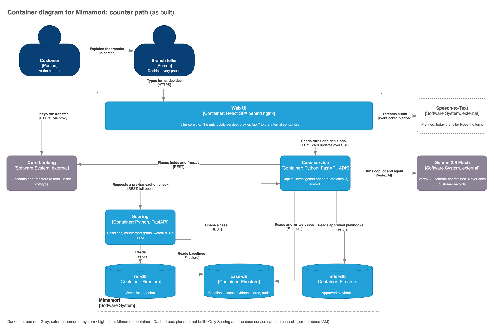
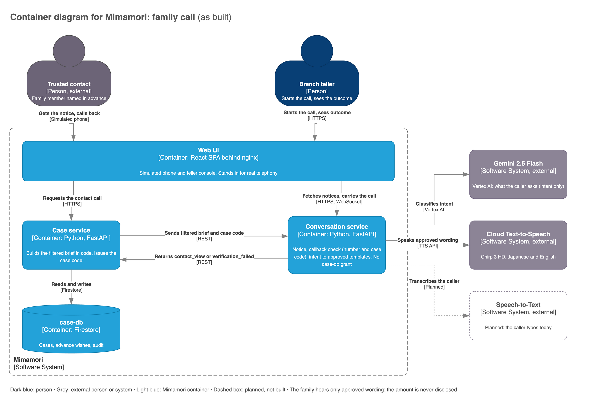
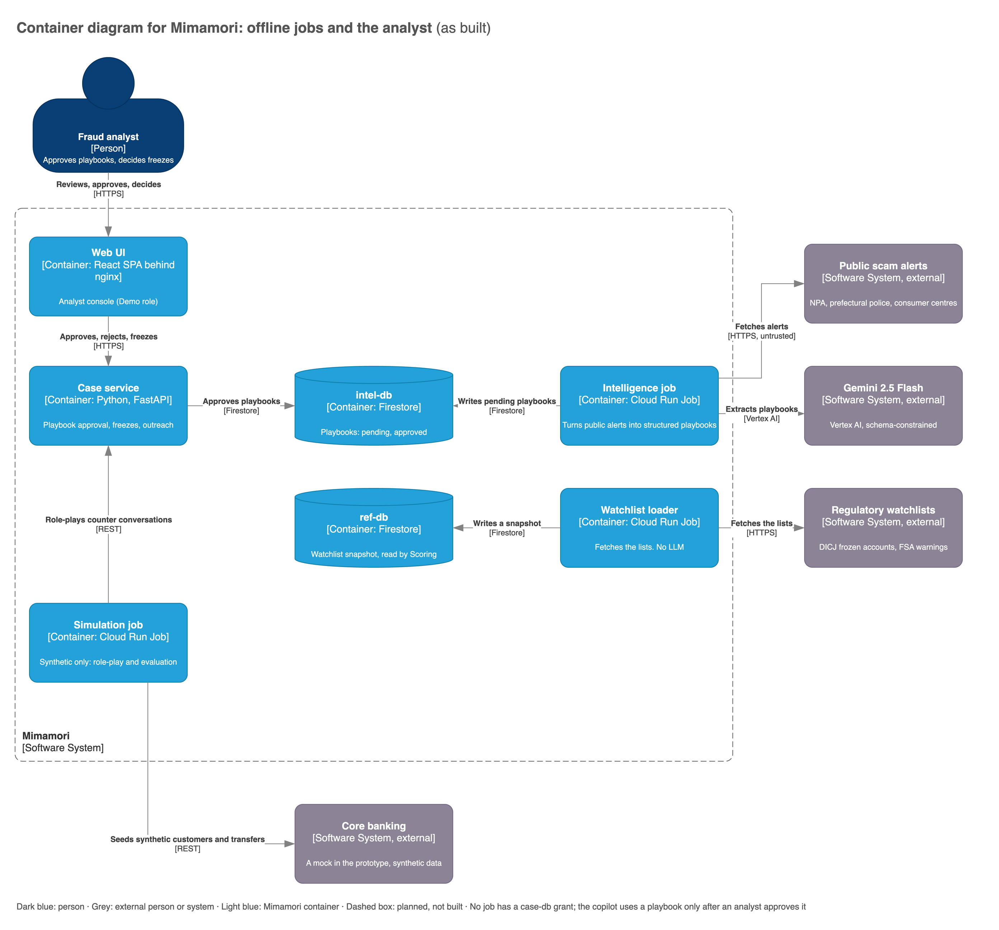

# C4 Level 2 — Containers: Mimamori 見守り

Parent: [`c4-context.md`](c4-context.md). Decisions: [`../decisions.md`](../decisions.md).

Decisions this diagram encodes:

- **Deployables split by trust boundary.** Customer records, people conversations, public text and
  synthetic data each run in their own containers, and the data boundary is enforced by deployment
  and IAM, not only by code.
- **Scoring is its own container with no LLM.** The agent loops in the case service never sit on
  the transaction path. Like every service in the prototype it scales to zero; production would
  keep a minimum instance.
- **Firestore as three databases:**
  - `case-db`: customer data
  - `intel-db`: public playbooks
  - `ref-db`: watchlists

  IAM conditions are set per database.
- **Copilot model (as built):** Gemini 2.5 Flash on Vertex AI, schema-constrained, with thinking off
  for structured calls. The design keeps it swappable to Gemma on an endpoint in the bank's project;
  the Gemma spike passed criteria 1–3 ([`../../spikes/gemma-copilot/RESULTS.md`](../../spikes/gemma-copilot/RESULTS.md)).
  The model extracts indicators with quotes, checks the cover story and picks a question **ID**.
  **Code** verifies quotes, computes the risk level and the pause recommendation (`risk-v1`), and
  fills the question from the approved bank ([`../../schemas/README.md`](../../schemas/README.md)).
- **Family call without the Live API:** the caller's turn → Gemini Flash classifies the intent →
  code fills templates → rule check → Cloud TTS. Turns are typed on a simulated phone in the browser
  today; Speech-to-Text is planned.
- **Region:** prototype `asia-south1`, set by a single config value (`MIMAMORI_REGION`). A
  production deployment for a Japanese bank uses `asia-northeast1`.

The diagrams show the prototype **as built** (dashed: planned) and are drawn in draw.io; the
sources are in [`diagrams/src/`](diagrams/src/). The containers are shown in three views so each
stays readable. The same container appears in
more than one view where it takes part in more than one flow.

### 2a · Counter path (scoring → investigation → copilot)

Source: [`diagrams/src/c4-containers-counter.drawio`](diagrams/src/c4-containers-counter.drawio)

### 2b · Family call (notice → verified callback → templated answers)

Source: [`diagrams/src/c4-containers-call.drawio`](diagrams/src/c4-containers-call.drawio)

### 2c · Offline path (intelligence, reference data, learning loop, evaluation)

Source: [`diagrams/src/c4-containers-offline.drawio`](diagrams/src/c4-containers-offline.drawio)

## Containers

| Container | Tech | Model | `case-db` access | Owns |
|---|---|---|---|---|
| Web UI | React SPA behind nginx, the only public Cloud Run service; proxies `/api/*` to the internal services. Demo roles (teller, analyst) from the Demo menu; IAP designed | — | None; goes through the services | Teller console, analyst console, simulated phone and phone menu |
| Scoring | Python, Cloud Run (scales to zero in the prototype) | none | **Yes** | Baseline computation, smart limits, counterpart graph, watchlist matching, pre-transaction check for counter / large transfers |
| Case service | Python, FastAPI, ADK | Gemini 2.5 Flash (Gemma designed) | **Yes** | Investigation agent (8 read-only tools), counter copilot loop, fact / quote checks, risk rule, approved question bank, guardrails, brief builder, learning-loop proposals, freeze requests |
| Conversation service | Python, Gemini Flash, Cloud TTS (STT planned) | Gemini | **None**; gets only the filtered brief | Outbound notice, callback verification (number + case code), intent classification, template fill, rule check |
| Watchlist loader | Cloud Run Job, scheduled | none | **None** | Fetches DICJ / FSA lists into `ref-db` |
| Intelligence job | Cloud Run Job, scheduled | Gemini | None | Alert fetch, playbook extraction (`published_at` kept), de-duplication, question bank |
| Simulation job | Cloud Run Job, synthetic-only environment | none (drives the case service's API) | None | Synthetic transactions, role-play, held-out cases, three-way evaluation |
| `case-db` | Firestore | — | — | Baselines, cases, evidence cards, advance wishes (versioned), learning-loop proposals, audit log |
| `intel-db` | Firestore | — | — | Playbooks (pending / approved), question bank |
| `ref-db` | Firestore | — | — | Watchlist snapshot |

## How the data boundary is enforced

1. **Only Scoring and the case service can use `case-db`.** Access is granted with **IAM
   conditions on each Firestore database**; Firestore has no per-collection IAM for server
   access. The loader and the conversation, intelligence and simulation containers have no
   grant, and Gemini never reads a database.
2. **The conversation service is stateless towards customer data.** It receives a brief the
   case service builds **in code** from the evidence card and the disclosure policy. The brief
   never contains the balance or any fact about another customer. The service returns only
   `contact_view {concerned, coming_to_branch}` or `verification_failed`.
3. **Public text never reaches the copilot unreviewed.** The intelligence job writes
   playbooks as `pending`. The case service reads only `approved` ones.
4. **The learning loop can't leak case text.** Proposals stay in `case-db`. After analyst
   approval, only structured playbook fields (cover-story phrase, payee pattern, payment
   method) are written to `intel-db`.
5. **The simulation job runs in a synthetic-only environment.** It can't move real cards to
   Gemini for judging.

## Untrusted inputs

These inputs are controlled by the scammer: payee names, transfer memos, and what the customer has been coached to say.

- They go into a delimited data block in the prompt, never into the instructions.
- The investigation tools are read-only.
- Output must match a fixed schema.
- The model only suggests; code and humans act.

## Failure modes

- **Scoring** runs before the transaction only for counter and large transfers. ATM and app transactions are monitored afterwards.
- **If scoring is down,** the transaction proceeds under the bank's existing controls.
- **If the case service or the model is down,** the teller falls back to today's process. The copilot is advisory.
- **Speech-to-Text is planned.** Today the teller types the turns; when STT is added, typing stays as the fallback.

## Cost

Model calls scale with alerts, not transactions: scoring has no model, and Gemini is called only
after a payment is flagged. Every Cloud Run service and job scales to zero, so the prototype costs
about $0 when idle. A self-hosted Gemma endpoint (designed) would add a GPU floor.

## Production design (not built)

- Append-only audit sink: Cloud Logging to BigQuery or GCS with a retention lock.
- ATM / app path: rules-only friction plus callback.
- Cross-bank fan-in: needs industry data sharing.
- Learning loop.
- Voice onboarding for advance wishes. In the prototype, Keiko's wishes are seeded as data.
- A real phone menu and telephony. In the prototype, both are simulated in the browser.

## Where the PDF components live

| PDF § | Component | Container |
|---|---|---|
| 6.1 | Counter copilot | Case service |
| 6.2 | Investigation agent | Case service |
| 6.3 | Scam intelligence agent | Intelligence job |
| 6.4 | Trusted-contact agent | Conversation service |
| 6.5 | Advance-wishes onboarding | Designed; seeded data in the prototype |
| 6.6 | Simulation & evaluation | Simulation job |
| 6.7 | Learning loop | Designed; case service → analyst → `intel-db` |
| — | Baseline, smart limits, counterpart graph | Scoring |

## Open items

- **Gemma (designed):** criteria 1–3 passed locally; latency on a Vertex endpoint (criterion 4) is
  untested. The prototype runs on Gemini 2.5 Flash (copilot turn 1.3–1.8 s).
- **Speech-to-Text (planned):** confirm streaming ja-JP Chirp availability in the chosen region.
- **Mock core banking:** shown as an external system so the integration boundary stays visible.
