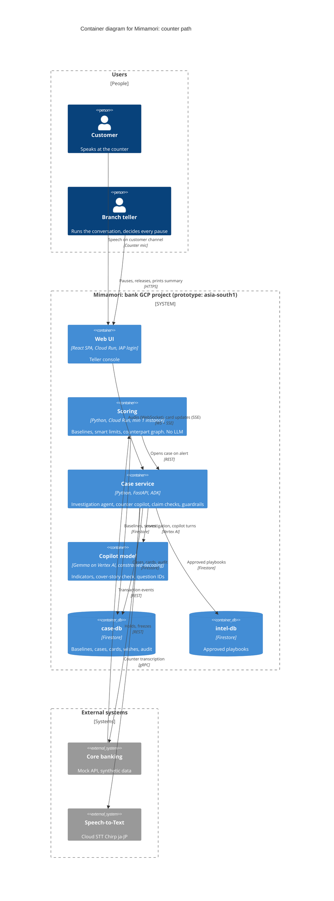
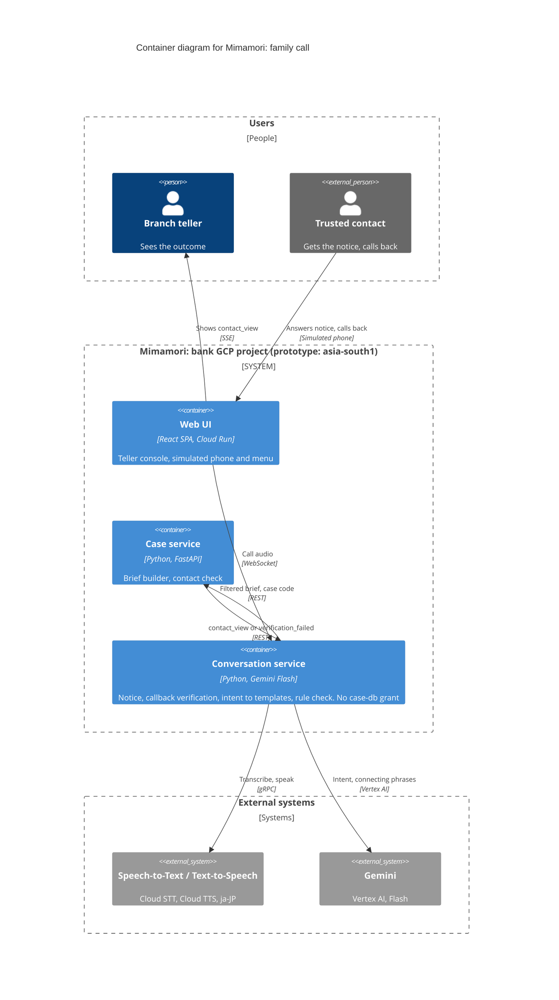
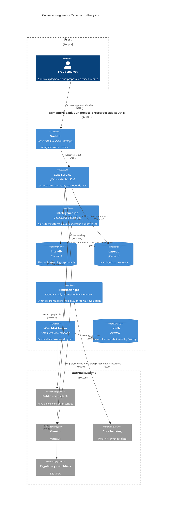

# C4 Level 2 — Containers: Mimamori 見守り

Parent: [`c4-context.md`](c4-context.md). Decisions: [`../decisions.md`](../decisions.md).

Decisions this diagram encodes:

- **Deployables split by trust boundary.** Customer records, people conversations, public text and
  synthetic data each run in their own containers. The Gemma–Gemini rule is enforced by
  deployment and IAM, not only by code.
- **Scoring is its own always-on container with no LLM.** The agent loops in the case service never
  sit on the transaction path.
- **Firestore as three databases:**
  - `case-db`: customer data
  - `intel-db`: public playbooks
  - `ref-db`: watchlists

  IAM conditions are set per database.
- **Copilot model:** Gemma on a Vertex AI endpoint in the bank's project, with constrained
  decoding. The spike passed criteria 1–3 ([`../../spikes/gemma-copilot/RESULTS.md`](../../spikes/gemma-copilot/RESULTS.md)).
  The model extracts indicators with quotes, checks the cover story and picks a question **ID**.
  **Code** verifies quotes, computes the risk level and the pause recommendation (`risk-v1`), and
  fills the question from the approved bank ([`../../schemas/README.md`](../../schemas/README.md)).
- **Family call without the Live API:** STT → Gemini Flash classifies the intent → code fills
  templates → rule check → TTS. Simulated phone and phone menu in the browser.
- **Region:** prototype `asia-south1`, set by a single config value (`MIMAMORI_REGION`). A
  production deployment for a Japanese bank uses `asia-northeast1`.

The containers are shown in three views so each stays readable. The same container appears in
more than one view where it takes part in more than one flow.

### 2a · Counter path (scoring → investigation → copilot)

Rendered: [`c4-containers-counter.png`](diagrams/c4-containers-counter.png)

### 2b · Family call (notice → verified callback → templated answers)

Rendered: [`c4-containers-call.png`](diagrams/c4-containers-call.png)

### 2c · Offline path (intelligence, reference data, learning loop, evaluation)

Rendered: [`c4-containers-offline.png`](diagrams/c4-containers-offline.png)

## Containers

| Container | Tech | Model | `case-db` access | Owns |
|---|---|---|---|---|
| Web UI | React SPA, Cloud Run, IAP with roles (teller, analyst) | — | None; goes through the services | Teller console, analyst console, simulated phone and phone menu |
| Scoring | Python, Cloud Run, min 1 instance | none | **Yes** | Baseline computation, smart limits, counterpart graph, watchlist matching, pre-transaction check for counter / large transfers |
| Case service | Python, FastAPI, ADK | Gemma (fallback Gemini) | **Yes** | Investigation agent (8 read-only tools), counter copilot loop, fact / quote checks, risk rule, approved question bank, guardrails, brief builder, learning-loop proposals, freeze requests |
| Copilot model | Vertex AI endpoint in the bank project | Gemma | **None** | Called only by the case service |
| Conversation service | Python, Gemini Flash, STT, TTS | Gemini | **None**; gets only the filtered brief | Outbound notice, callback verification (number + case code), intent classification, template fill, rule check |
| Watchlist loader | Cloud Run Job, scheduled | none | **None** | Fetches DICJ / FSA lists into `ref-db` |
| Intelligence job | Cloud Run Job, scheduled | Gemini | None | Alert fetch, playbook extraction (`published_at` kept), de-duplication, question bank |
| Simulation job | Cloud Run Job, synthetic-only environment | Gemini | None | Synthetic transactions, role-play, held-out cases, three-way evaluation |
| `case-db` | Firestore | — | — | Baselines, cases, evidence cards, advance wishes (versioned), learning-loop proposals, audit log |
| `intel-db` | Firestore | — | — | Playbooks (pending / approved), question bank |
| `ref-db` | Firestore | — | — | Watchlist snapshot |

## How the data boundary is enforced

1. **Only Scoring and the case service can use `case-db`.** Access is granted with **IAM
   conditions on each Firestore database**; Firestore has no per-collection IAM for server
   access. The copilot model, the loader, and the conversation, intelligence and simulation
   containers have no grant.
2. **The conversation service is stateless towards customer data.** It receives a brief the
   case service builds **in code** from the evidence card and the disclosure policy. The brief
   never contains the balance or any fact about another customer. The service returns only
   `contact_view {concerned, coming_to_branch}` or `verification_failed`.
3. **Public text never reaches the Gemma path unreviewed.** The intelligence job writes
   playbooks as `pending`. The case service reads only `approved` ones.
4. **The learning loop can't leak case text.** Proposals stay in `case-db`. After analyst
   approval, only structured playbook fields (cover-story phrase, payee pattern, payment
   method) are written to `intel-db`.
5. **The simulation job runs in a synthetic-only environment.** It can't move real cards to
   Gemini for judging.

## Untrusted inputs

These inputs are controlled by the scammer: payee names, transfer memos, and what the customer has been coached to say.

- They go into a delimited data block in the prompt, never into the instructions.
- The investigation tools are read-only.
- Output must match a fixed schema.
- The model only suggests; code and humans act.

## Failure modes

- **Scoring** runs before the transaction only for counter and large transfers. ATM and app transactions are monitored afterwards.
- **If scoring is down,** the transaction proceeds under the bank's existing controls.
- **If the case service or the model is down,** the teller falls back to today's process. The copilot is advisory.
- **If STT misbehaves,** the teller types the turns. This is also the demo fallback.

## Cost

Model calls scale with alerts, not transactions. A GPU endpoint has a fixed floor, though: at
least one replica runs all the time. Undeploy it between development sessions.

## Production design (not built)

- Append-only audit sink: Cloud Logging to BigQuery or GCS with a retention lock.
- ATM / app path: rules-only friction plus callback.
- Cross-bank fan-in: needs industry data sharing.
- Learning loop.
- Voice onboarding for advance wishes. In the prototype, Keiko's wishes are seeded as data.
- A real phone menu and telephony. In the prototype, both are simulated in the browser.

## Where the PDF components live

| PDF § | Component | Container |
|---|---|---|
| 6.1 | Counter copilot | Case service |
| 6.2 | Investigation agent | Case service |
| 6.3 | Scam intelligence agent | Intelligence job |
| 6.4 | Trusted-contact agent | Conversation service |
| 6.5 | Advance-wishes onboarding | Designed; seeded data in the prototype |
| 6.6 | Simulation & evaluation | Simulation job |
| 6.7 | Learning loop | Designed; case service → analyst → `intel-db` |
| — | Baseline, smart limits, counterpart graph | Scoring |

## Open items

- **Gemma latency:** criteria 1–3 passed locally; latency on the Vertex endpoint (criterion 4) is untested.
- **Availability in `asia-south1`:** confirm Gemma GPU quota and streaming ja-JP Chirp STT.
  Anything missing can use another region for this synthetic-data prototype, stated in the brief.
- **Mock core banking:** shown as an external system so the integration boundary stays visible.
