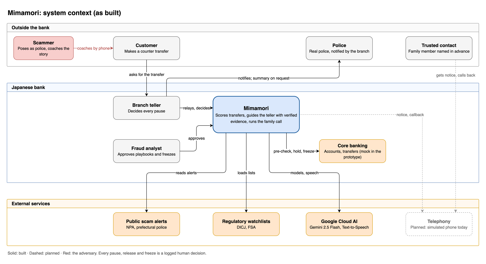

# C4 Level 1 — System Context: Mimamori 見守り

Design decisions: [`../decisions.md`](../decisions.md).

At this level Mimamori is a single box. The diagram shows **who** uses it, **what external
systems** it depends on, and **where data crosses the bank's boundary**. Containers are in
[`c4-containers.md`](c4-containers.md).

Drawn in draw.io as built: [`diagrams/src/c4-context.drawio`](diagrams/src/c4-context.drawio). Dashed
elements are designed but not built.

## Elements

| Element | Type | Role in Mimamori |
|---|---|---|
| Customer | Person (outside the bank) | Subject of protection. Protected by the copilot whether or not they have advance wishes. With wishes: trusted contact, disclosure policy, a pre-agreed cooling-off pause (at least 4 h, extended to the next business-day close, at most 24 h) that works as a delay, not a prohibition. Never judged by age. |
| Branch teller | Person | Uses the counter copilot. **A human decides every hold.** Notifies the police. |
| Fraud analyst | Person | Approves pending playbooks and structured learning-loop changes. **Decides freezes** of same-bank mule accounts. |
| Trusted contact | Person (external) | Nominated in advance. Gets a notice that reveals nothing, then, after calling back on the published number with the case code, only what the disclosure policy allows. Their reply is **information**, never an instruction. |
| Police | Person (external) | The real police are the direct answer to a fake-police script. Notified by the teller. The attending officers receive the evidence summary on request, limited to what they ask for. |
| Scammer | Person (external) | Not a user. Shown because the coached cover story they plant is the core evidence Mimamori looks for. |
| Core banking | External system | Transfers, channels and same-bank counterpart accounts. Mocked in the prototype. |
| Public scam alerts | External system | Japanese prose, treated as **untrusted input**. Each alert keeps its publication date for the evaluation date split. |
| Regulatory watchlists | External system | DICJ frozen accounts, FSA unregistered firms. Loaded by a deterministic job. |
| Google Cloud AI | External system | **As built:** Gemini 2.5 Flash on Vertex AI for the copilot, the investigation agent, the family-call intent and playbook extraction; Cloud Text-to-Speech for the family call. Designed, not built: Gemma for reasoning over customer records (self-hostable), and Speech-to-Text. |
| Telephony | External system | Carries the outbound notice and the inbound callback. **Planned:** the prototype uses a simulated phone in the browser. |

## Where case information leaves the bank's project

The claim is **"reasoning over customer records is self-hostable with open weights"**, not "no
external API". Every path by which case information reaches a service outside the bank's own
deployments:

| Path | What it carries | Mitigation |
|---|---|---|
| Speech-to-Text (managed, **planned**) | Counter audio, the contact's speech | Not built: the prototype takes typed turns. Same cloud and region when added; designed self-host option: Kotoba-Whisper on a GPU. |
| Gemini (managed) | Counter turns and tool results for the copilot and investigation agent; the filtered brief and the contact's turns for the family call | Untrusted text goes in a delimited data block; schema-constrained output; never raw customer records. The family brief is built in code: no balance, no other customers' data. |
| Text-to-Speech (managed) | Approved template text | Only text that passed the rule check. |
| Telephony | The notice (bank name, "about your mother", case code) and the callback | Notice consented to in the advance wishes. Disclosure only after verification. |
| Police | Evidence summary, on the attending officers' request | APPI Art. 27(1)(i) via a CCP Art. 197(2) inquiry; Art. 27(1)(iv) as secondary basis. Scope limited to the request. Officer name and title logged. |

**As built,** the prototype runs every model call on Gemini 2.5 Flash (Vertex AI). The design keeps
reasoning over customer records swappable to Gemma on an endpoint in the bank's own project, or on
the bank's own hardware.

**Region:** prototype `asia-south1`; production target for a Japanese bank `asia-northeast1`.
All prototype data is synthetic.

## Transaction paths

- **Pre-transaction:** counter transfers and large transfers. A person is waiting anyway, so
  scoring runs before the money moves.
- **Post-transaction:** ATM and app. Monitored after the fact with a rules-only response
  (designed, not built).
- **If scoring is unavailable,** the transaction proceeds under the bank's existing controls.

## Next

- [`c4-containers.md`](c4-containers.md): Level 2, live and offline views.
- [`c4-dynamic-tanaka.md`](c4-dynamic-tanaka.md): the Tanaka case, step by step.
