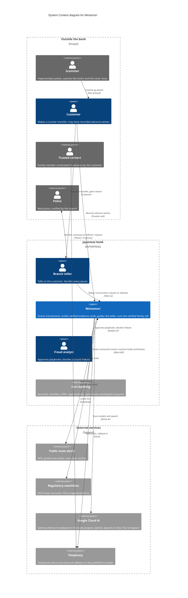

# C4 Level 1 — System Context: Mimamori 見守り

Source of truth: `Mimamori_Solution.pdf` (AI Builder Cup 2026 solution brief), as amended by
[`../decisions.md`](../decisions.md) until the deck is regenerated. `PROPOSAL.md` is deprecated.

At this level Mimamori is a single box. The diagram shows **who** uses it, **what external
systems** it depends on, and **where data crosses the bank's boundary**. Containers are in
[`c4-containers.md`](c4-containers.md).

Rendered: [`c4-context.png`](diagrams/c4-context.png)

## Elements

| Element | Type | Role in Mimamori |
|---|---|---|
| Customer | Person (outside the bank) | Subject of protection. Protected by the copilot whether or not they have advance wishes. With wishes: trusted contact, disclosure policy, a pre-agreed cooling-off pause (at least 4 h, extended to the next business-day close, at most 24 h) that works as a delay, not a prohibition. Never judged by age. |
| Branch teller | Person | Uses the counter copilot. **A human decides every hold.** Notifies the police. |
| Fraud analyst | Person | Approves pending playbooks and structured learning-loop changes. **Decides freezes** of same-bank mule accounts. |
| Trusted contact | Person (external) | Nominated in advance. Gets a notice that reveals nothing, then, after calling back on the published number with the case code, only what the disclosure policy allows. Their reply is **information**, never an instruction. |
| Police | Person (external) | The real police are the direct answer to a fake-police script. Notified by the teller. The attending officers receive the evidence summary on request, limited to what they ask for. |
| Scammer | Person (external) | Not a user. Shown because the coached cover story they plant is the core evidence Mimamori looks for. |
| Core banking | External system | Transfers, channels and same-bank counterpart accounts. Mocked in the prototype. |
| Public scam alerts | External system | Japanese prose, treated as **untrusted input**. Each alert keeps its publication date for the evaluation date split. |
| Regulatory watchlists | External system | DICJ frozen accounts, FSA unregistered firms. Loaded by a deterministic job. |
| Google Cloud AI | External system | Gemma (customer records), Gemini (public data, synthetic data, the family call), STT and TTS. |
| Telephony | External system | Carries the outbound notice and the inbound callback. Simulated in the browser for the prototype. |

## Where case information leaves the bank's project

The claim is **"reasoning over customer records is self-hostable with open weights"**, not "no
external API". Every path by which case information reaches a service outside the bank's own
deployments:

| Path | What it carries | Mitigation |
|---|---|---|
| Speech-to-Text (managed) | Counter audio, the contact's speech | Same cloud and region. Designed self-host option: Kotoba-Whisper on a GPU. |
| Gemini (managed) | The filtered brief, the contact's transcribed turns | Brief built in code. No balance, no other customers' data. |
| Text-to-Speech (managed) | Approved template text | Only text that passed the rule check. |
| Telephony | The notice (bank name, "about your mother", case code) and the callback | Notice consented to in the advance wishes. Disclosure only after verification. |
| Police | Evidence summary, on the attending officers' request | APPI Art. 27(1)(i) via a CCP Art. 197(2) inquiry; Art. 27(1)(iv) as secondary basis. Scope limited to the request. Officer name and title logged. |

Gemma runs on a Vertex AI endpoint deployed in the bank's own project. The same weights can
run on the bank's own hardware.

**Region:** prototype `asia-south1`; production target for a Japanese bank `asia-northeast1`.
All prototype data is synthetic.

## Transaction paths

- **Pre-transaction:** counter transfers and large transfers. A person is waiting anyway, so
  scoring runs before the money moves.
- **Post-transaction:** ATM and app. Monitored after the fact with a rules-only response
  (designed, not built).
- **If scoring is unavailable,** the transaction proceeds under the bank's existing controls.

## Next

- [`c4-containers.md`](c4-containers.md): Level 2, live and offline views.
- [`c4-dynamic-tanaka.md`](c4-dynamic-tanaka.md): the Tanaka case, step by step.
