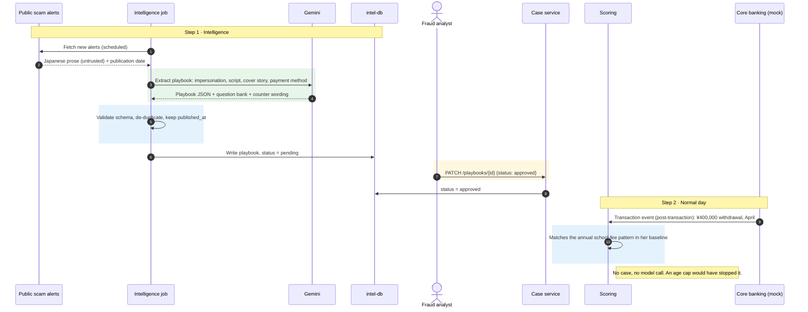
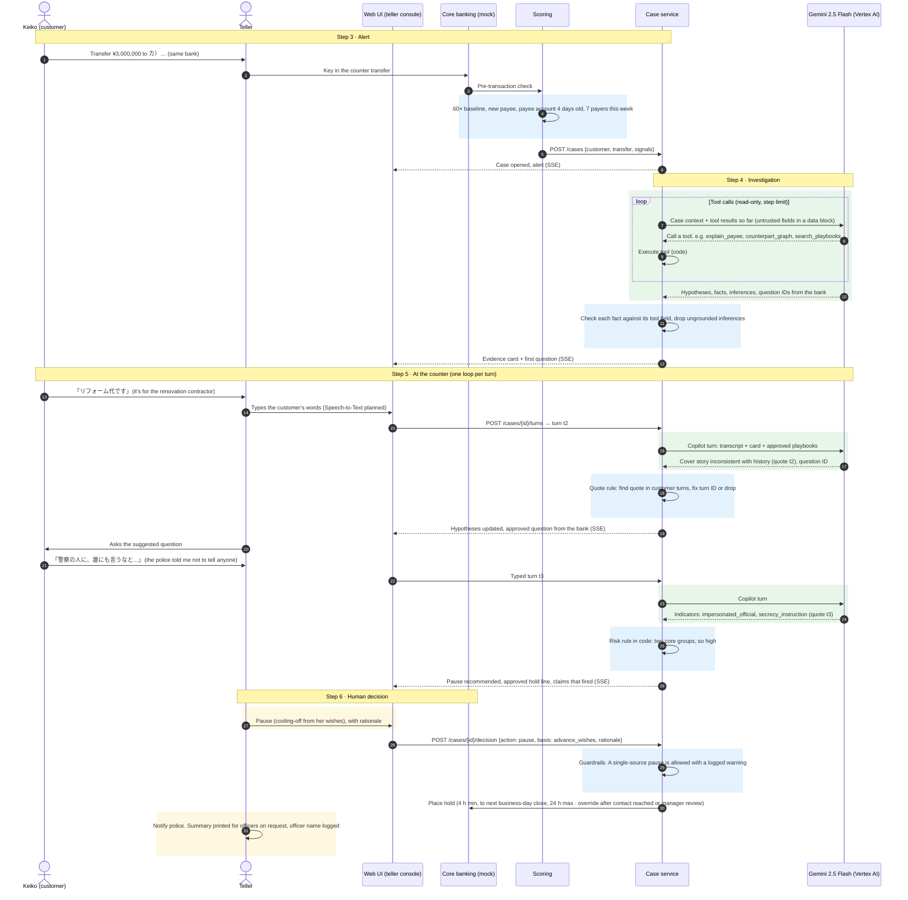
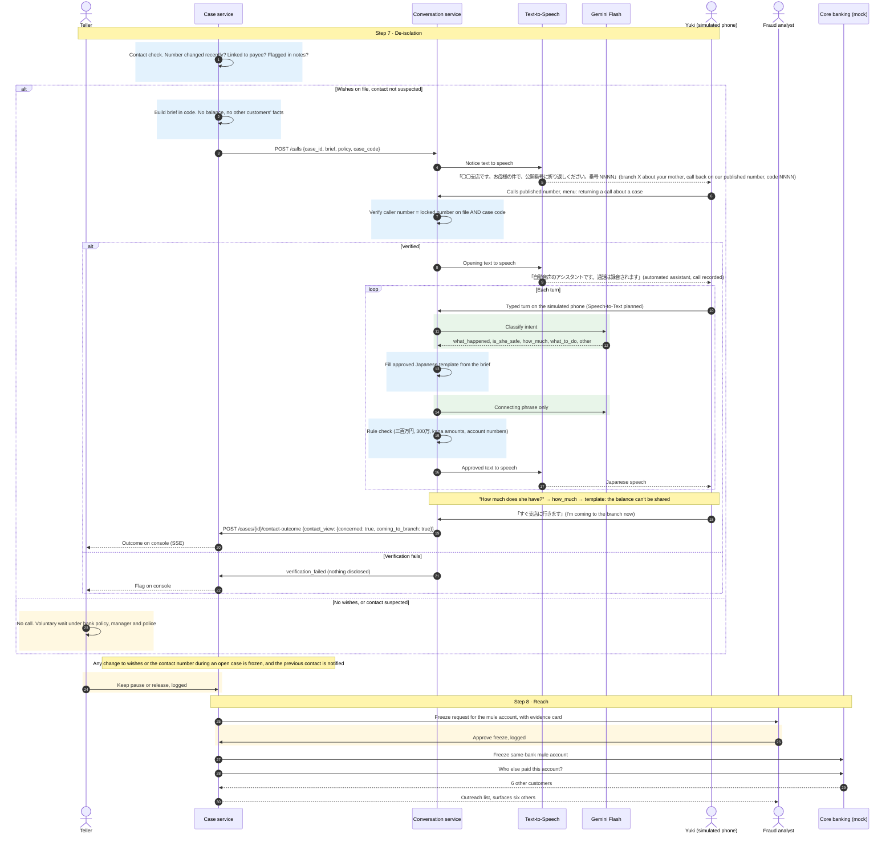

# C4 Dynamic — The Tanaka case, end to end

Source: `Mimamori_Solution.pdf` §9, as amended by [`../decisions.md`](../decisions.md).
Containers: [`c4-containers.md`](c4-containers.md).

Tanaka Keiko, 78, a twelve-year customer with a baseline of ¥50,000 monthly withdrawals. Her
advance wishes, recorded at an earlier counter visit, name her daughter Yuki as the trusted
contact. They consent to a notice call and agree to a cooling-off pause (at least 4 h, extended to the next business-day close, at most 24 h). She can
override once the nominated contact has been reached, or after manager review with a second confirmation. All data is synthetic.

This is also the script for the ~3-minute video. Step numbers in the headings match PDF §9. The
flow is split into three diagrams so each stays readable. They show the prototype as built: the
copilot runs on Gemini 2.5 Flash (Gemma designed), the teller and the family member type their
turns (Speech-to-Text planned), and the phone is simulated in the browser. API paths are the proposed contracts
between containers.

**Colour key:** blue boxes are deterministic code, green boxes are model calls, yellow boxes are
human decisions.

---

## A · Before the visit (steps 1–2)

Rendered: [`c4-dynamic-tanaka-a.png`](diagrams/c4-dynamic-tanaka-a.png)

## B · At the counter (steps 3–6)

Rendered: [`c4-dynamic-tanaka-b.png`](diagrams/c4-dynamic-tanaka-b.png)

## C · After the pause (steps 7–8)

Rendered: [`c4-dynamic-tanaka-c.png`](diagrams/c4-dynamic-tanaka-c.png)

Step 9 (proof) runs offline in the simulation job. See diagram 2c in
[`c4-containers.md`](c4-containers.md).

## Design points this flow pins down

1. **No model call on a normal day.** Step 2 is post-transaction monitoring in Scoring. Model
   cost grows with alerts, not transactions.
2. **The mule account is at the same bank.** Only then are its age and its payers visible, and
   only then can the bank freeze it. Cross-bank fan-in is designed, not built.
3. **The model never executes anything.** It requests read-only tools and the case service runs
   them. Payee names, memos and transcripts are untrusted data.
4. **Every claim is grounded.**
   - Facts are checked against tool fields.
   - Quotes must appear in a customer turn (exact, then after NFKC and whitespace removal). A wrong turn ID is corrected and an unfound quote is dropped.
   - Inferences ("coached cover story", "fake police") must cite a verified fact or quote, and are shown as hypotheses.
5. **The pause has a stated basis.**
   - With wishes: the pre-agreed cooling-off pause (at least 4 h, extended to the next business-day close, at most 24 h). A delay, not a prohibition: she can override once the nominated contact has been reached, or after manager review with a second confirmation.
   - Without wishes: a voluntary wait under bank policy, plus police.
   - The teller always decides, and is never blocked.
6. **The police are part of the response.** The real police are the answer to a fake-police script.
   The teller notifies them. Officers get the evidence summary on request, limited to what they ask,
   and the officer's name and title are logged (APPI Art. 27(1)(i) via CCP Art. 197(2)).
7. **The family call can't over-disclose by design.**
   - The notice reveals nothing.
   - Disclosure starts only after a callback that matches the number and the case code. This lets Yuki verify the bank and blocks strangers. It isn't proof of her identity, which rests on the number verified at registration and locked during the case.
   - The agent first says it is an automated assistant and that the call is recorded.
   - Gemini classifies intent, and code fills approved templates from a brief that holds no balance and no other customers' data.
8. **Yuki's reply is information** (`contact_view`), never an instruction.
9. **A human decides the freeze.** The same rule as holds: the analyst approves, and the decision is logged.
10. **Code, not the model, decides risk.** The model (Gemini 2.5 Flash as built) extracts indicators and quotes, checks the cover
    story and picks a question ID. Code accumulates verified indicators, computes the risk level
    and the pause recommendation (`risk-v1`), and fills every word the teller says from the
    approved bank. The model's own likelihood numbers are not used (Gemma spike, finding 1).
