# Demo scenarios: sequence diagrams

One diagram per scenario in the [scripted demo](../../demo/README.md). Each shows what the
judge sees (people and the console) and what happens behind it, with the services as built.
Rendered PNGs are in [`diagrams/`](diagrams/).

**Who decides what:**
- **Code** decides whether a case opens (Scoring) and how risky it is (`risk-v1`).
- **Models** only read language: the copilot reads the counter conversation, and Gemini classifies
  the family's questions.
- **People** make every decision.

| Scenario | Story | Diagram |
|---|---|---|
| `hero` | Tanaka, fake police, Japanese: alert, copilot, pause, family call, freeze, outreach | [hero](#hero) |
| `hero-en` | The same flow in English: a language pack, not a rebuild | [hero-en](#hero-en) |
| `genuine` | A real renovation: no pause | [genuine](#genuine) |
| `impostor` | A stranger calls back with a wrong code: nothing disclosed | [impostor](#impostor) |
| `small` | ¥300 to a suspicious account: no friction | [small](#small) |
| `split` | Two payments of ¥90,000: the running total opens a case | [split](#split) |

## hero

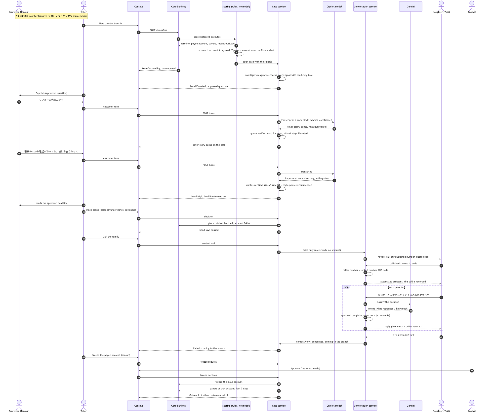

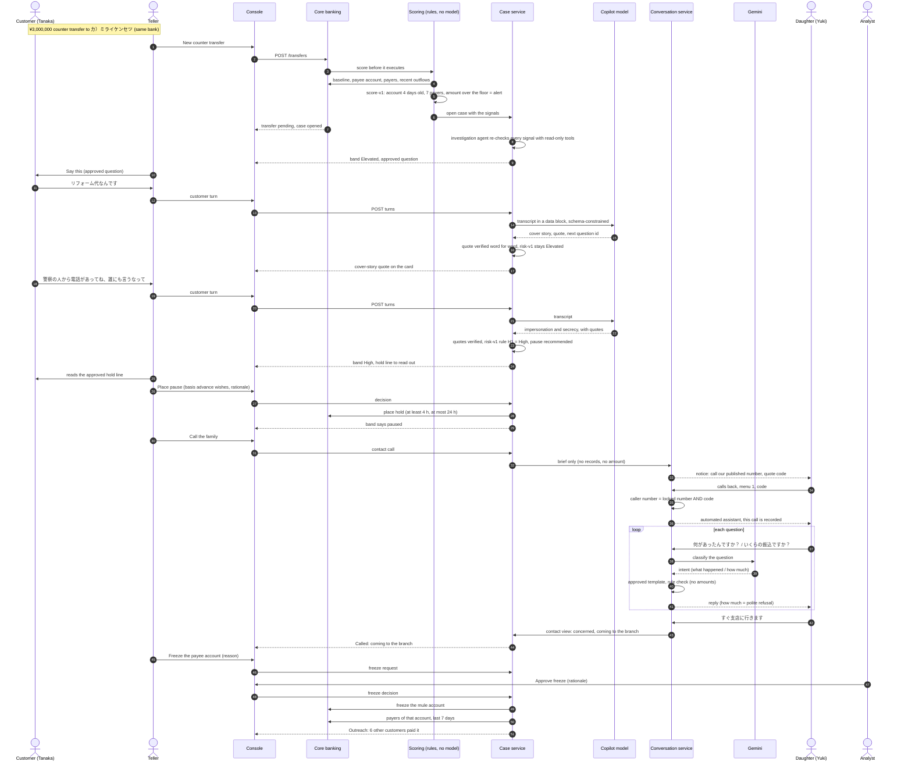

## hero-en

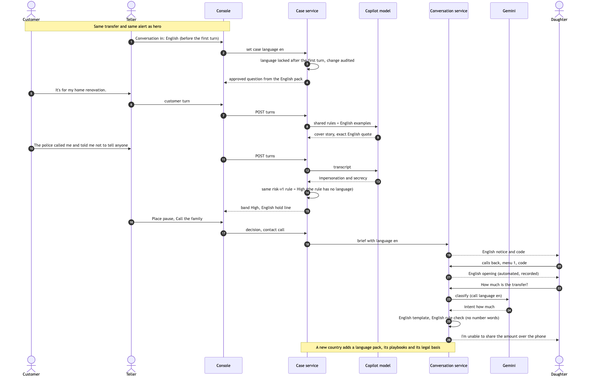

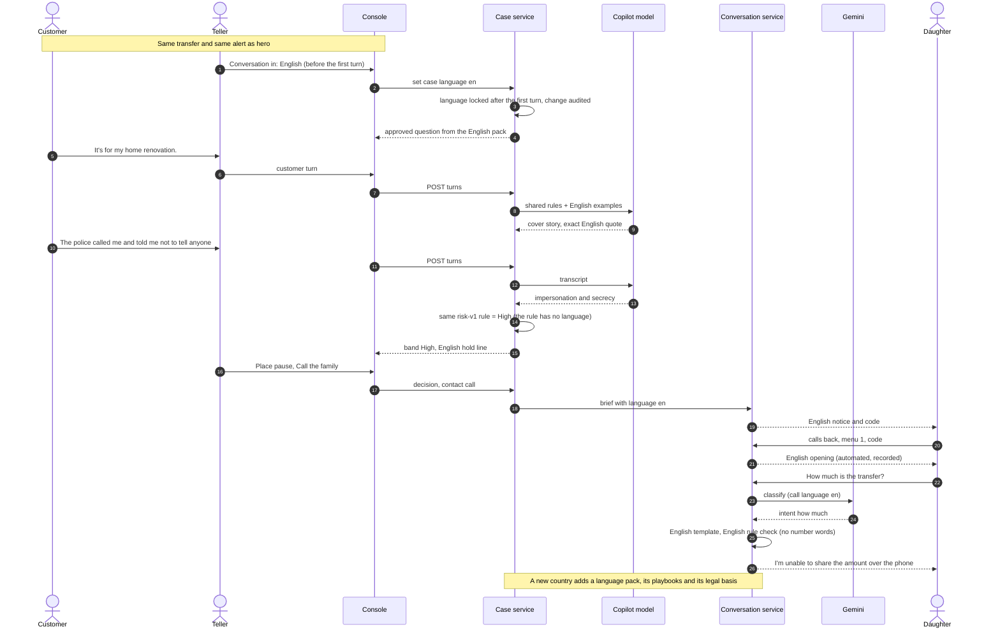

## genuine

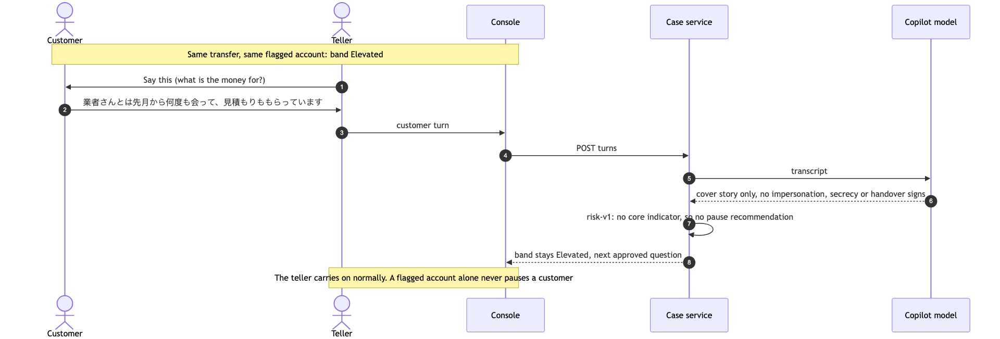

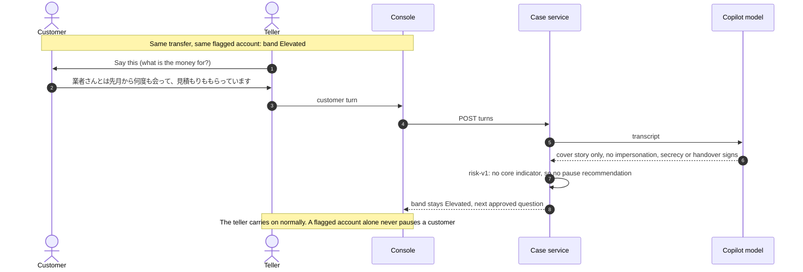

## impostor

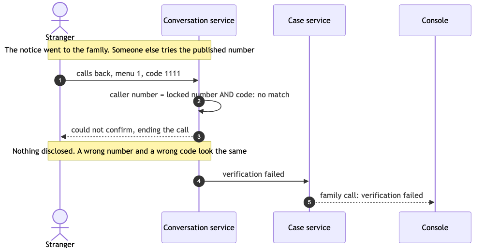

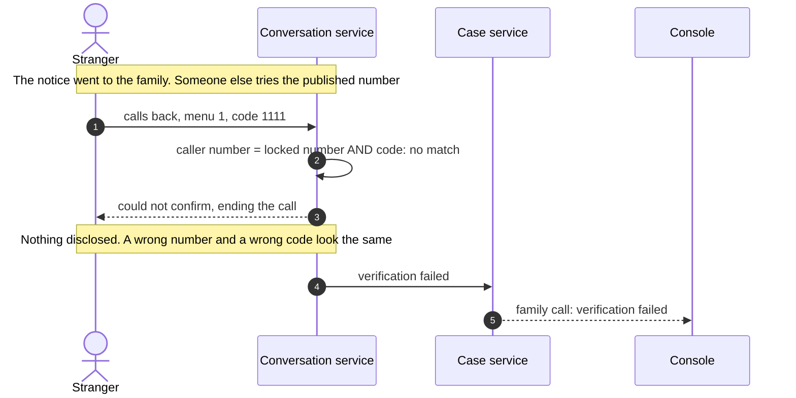

## small

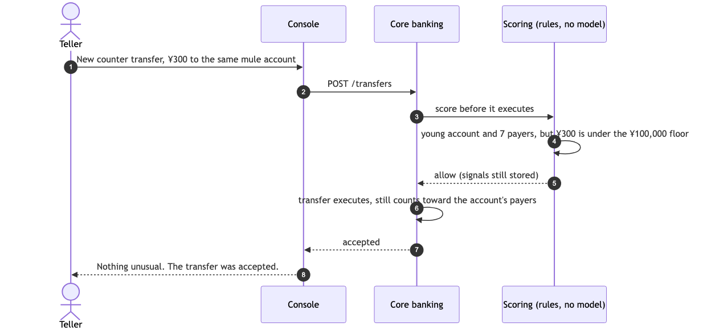

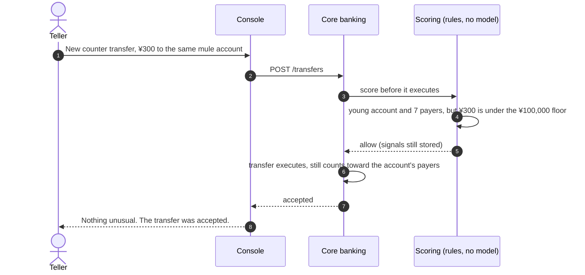

## split

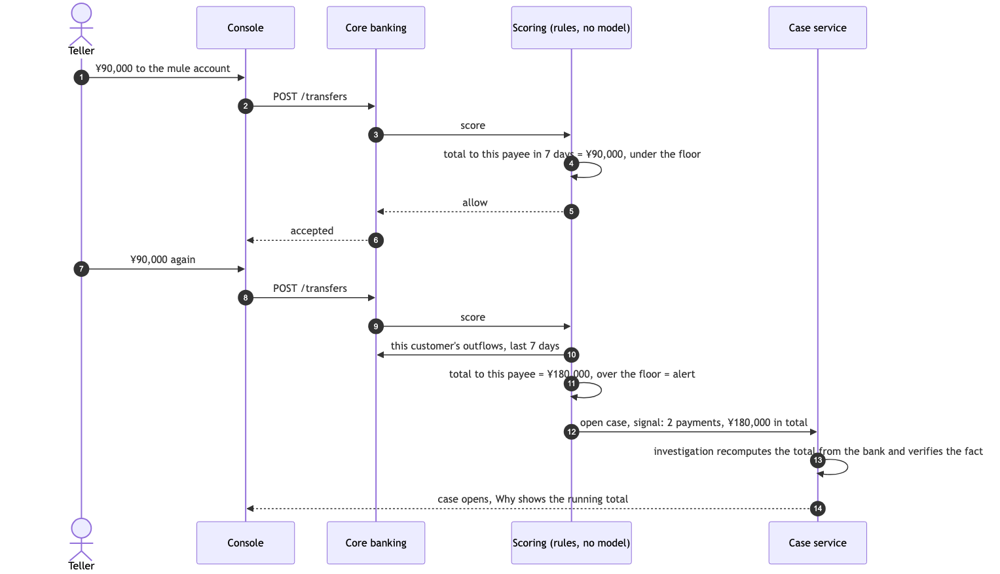

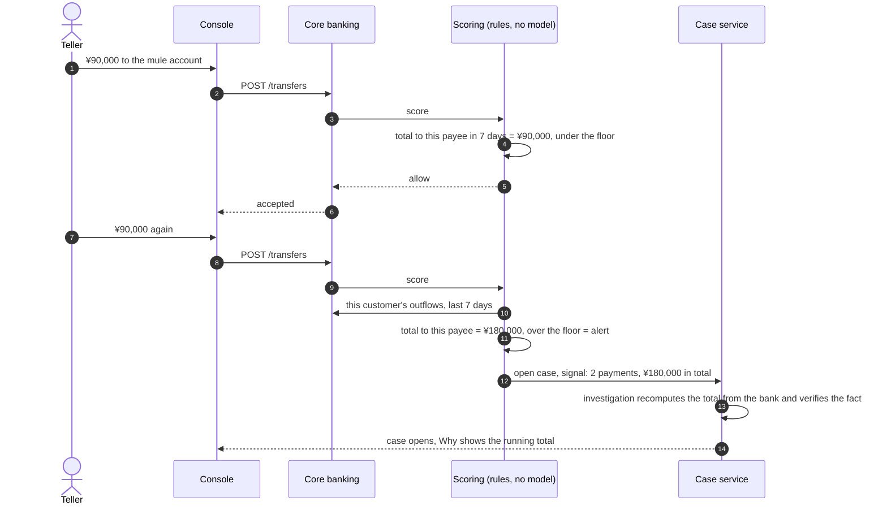
